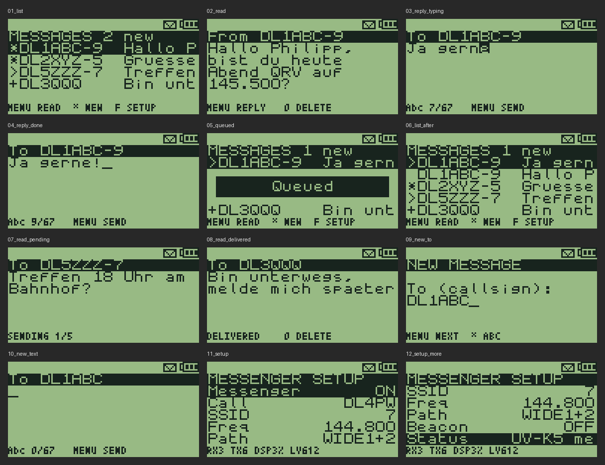

# APRS messenger

Text messages over APRS, without a phone or a computer. The radio decodes APRS
in the background while it works as usual, acknowledges messages for your
callsign, keeps them in a mailbox in its flash, beeps and shows an envelope.
You read and answer them later, typing on the number keys.



> [!WARNING]
> **Status: built and tested on the host only.** Every part that runs without
> the radio has host tests (protocol, demodulator on simulated audio,
> mailbox on a simulated NOR flash, messenger logic, text entry, screens).
> The parts that touch the hardware (audio capture, transmitter, beeps) have
> not run on a radio yet. Check them with the [bench tests](#bench-tests)
> before relying on it.

## What you need

- A **Quansheng UV-K1 or UV-K5 V3** (PY32F071). The UV-K5 V1/V2 cannot run it.
- An **amateur radio licence**: APRS transmits.
- One VFO on the **APRS frequency** (144.800 MHz in IARU Region 1), FM, wide.

## Build and flash

```
cmake --preset Messenger
cmake --build --preset Messenger
```

The image is `build/Messenger/f4hwn.messenger.bin`. Flash it like any F4HWN
Fusion release, with [UV Studio](https://armel.github.io/uvstudio/), and back up
the calibration data first.

The Messenger edition is Fusion plus the messenger, minus the spectrum
analyser (flash: 95 % of 118 KiB, RAM: 85 % of 16 KiB).

## First steps

1. **Side key:** Menu → the side key settings (`F1Shrt`, `F1Long`, `F2Shrt`,
   `F2Long` or `M Long`) → **MESSAGES**.
2. Press it: the mailbox opens. **F** opens the setup.
3. Set **Call** (without SSID; taken from the boot message if that looks like
   a callsign), **SSID** (7 is usual for handhelds), then **Messenger: ON**.
4. Tune a VFO to **144.800 FM**, squelch low (1 or 2), and leave it there:
   alone, or as one side of dual watch.
5. 20 seconds later the radio sends its first status beacon, then one every
   30 minutes. iGates only route messages from the Internet to stations they
   have heard recently.

## Keys

| Screen | Key | Action |
|---|---|---|
| Mailbox | UP / DOWN | select |
| | MENU | read |
| | `*` | new message |
| | F | setup |
| | EXIT | back to the main screen |
| Reading | UP / DOWN | scroll |
| | MENU | reply (incoming) / send again (outgoing without ack) |
| | 0 | delete (asks first) |
| Writing | 0-9 | multi-tap: `2` = a b c 2, `0` = space 0, `1` = `. , ? ! ' - / : @ ( ) + = * # 1` |
| | `*` | Abc → abc → ABC → 123 |
| | UP / DOWN | cursor left / right |
| | EXIT | delete; on an empty text back to the recipient; held: cancel |
| | MENU | recipient: next; text: send |
| Setup | UP / DOWN | select |
| | MENU / F | next / previous value, or edit |

A letter is fixed one second after the last tap, or at once with another key.
Messages hold up to 67 characters (the APRS limit).

### Mailbox marks

| Mark | Meaning |
|---|---|
| `*` | new, not read |
| (blank) | read |
| `>` | sending: waits for the ack, retries after 30, 60, 120 and 240 s |
| `+` | delivered (acknowledged) |
| `!` | no ack after 5 transmissions, or rejected: MENU sends it again |
| `-` | sent before a restart, no ack yet |

## How it behaves

- **APRS stays silent.** With *APRS audio* off (default), a burst on the APRS
  frequency does not open the speaker and does not interrupt the FM radio;
  only dual watch holds on that VFO until the burst ends.
- **Acks** go out by themselves, 0.7 to 3 s after the channel is clear.
  Copies of a message through other digipeaters are not acknowledged again;
  a retry of the sender (30 s or more later) is.
- **Safety limits:** at least 3 s between two of its own frames, at most 6 in a
  burst, then one per 30 s. Nothing is sent while you transmit, receive,
  scan, or while the channel is busy.
- **Power save** stays off while a VFO is on the APRS frequency: the receiver
  must hear the start of each burst. This costs battery.
- **The FM radio** keeps playing; APRS bursts may be heard faintly over it
  (the BK4829 audio has to be on for the decoder while a burst comes in).
- **Messages from the Internet** (APRS-IS, aprs.fi, APRSdroid via an iGate)
  arrive as third-party frames and are handled like local ones; the ack goes
  to the original sender.
- **Umlauts:** received UTF-8 or Latin-1 umlauts become ae, oe, ue, ss.

## Setup items

| Item | Values |
|---|---|
| Messenger | ON / OFF (needs a callsign) |
| Call, SSID | your station; SSID 0 = none |
| Freq | 144.800, 144.390, 144.640, 144.660, 145.175, 145.825 |
| Path | DIRECT, WIDE1 (WIDE1-1), WIDE1+2 (WIDE1-1,WIDE2-1) |
| Beacon | OFF, 10, 20, 30, 60 min: a status frame (`>text`), no position |
| Status | beacon text, up to 20 characters |
| Beep | on a new message |
| APRS audio | ON: bursts on the APRS frequency are heard as usual |
| Clear mailbox | erases all messages (asks first) |

The bottom line shows bring-up figures: frames heard (`RX`) and sent (`TX`),
decoder load (`DSP`, % of the CPU), audio level at the ADC (`LV`, peak to peak
in ADC codes over 100 ms) and late decoder blocks (`OV`, only when there are any).

## Bench tests

Two radios, both with this firmware, call A and B, VFOs on 144.800 (or a
free simplex frequency for the first tests, set under Freq on both).

1. **Audio level.** Setup on A, no signal: `LV` shows noise (squelch closed
   or open), `DSP` a few %. A burst from B (or any APRS station): `LV` should
   reach several hundred. 0 means the capture does not run (no VFO on the
   frequency, or messenger off).
2. **Receive.** Send from B to A. On A: two tones, envelope, `RX` counts up,
   the message is in the mailbox. B shows `+` after a few seconds.
3. **FM radio.** Play the FM radio on A, send from B: does the message arrive,
   how loud is the burst over the music, does the music continue?
4. **Dual watch.** A: VFO A on 144.800, VFO B on a voice channel, dual watch on.
   Messages from B must still arrive (retries help).
5. **Key beeps.** Press keys on A with key beep on, then send from B: must
   still decode (the messenger switches the BK4829 audio back on).
6. **Battery reading.** The battery voltage on A must stay plausible while the
   messenger runs (the capture lends the ADC to the battery measurement).
7. **Real network.** Beacon on, wait for the status to show on aprs.fi, then
   send a message from aprs.fi or APRSdroid to A, and from A to that station.
8. **Current draw.** Standby with and without the messenger.

Report anything odd with a photo of the setup screen (the bottom line).

## Host tests

```
App/messenger/test/run.sh [OUTDIR]
```

builds and runs everything on the PC (gcc, python3; the demodulator test
generates its audio with the channel model of the APRS RX app). The screen
simulator writes `OUTDIR/screens/*.lcd`; `test/render_lcd.py OUTDIR/screens`
turns them into PNG files like the one above.

## Not yet

- Predictive T9 (a word list in the external flash): only multi-tap so far.
- Times: the radio has no clock; the mailbox keeps the order only.
- Bulletins, groups, position beacons, a station list.

Design notes: [DESIGN.md](DESIGN.md).
